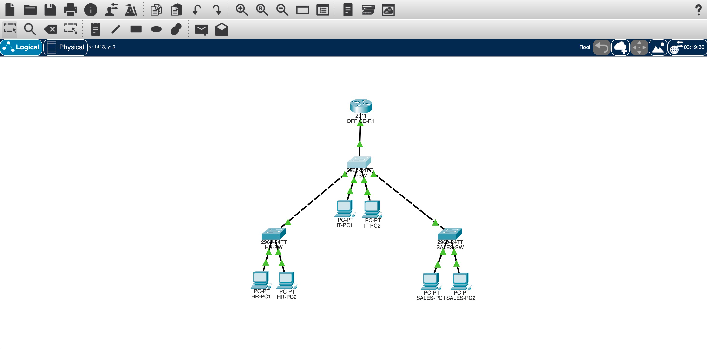
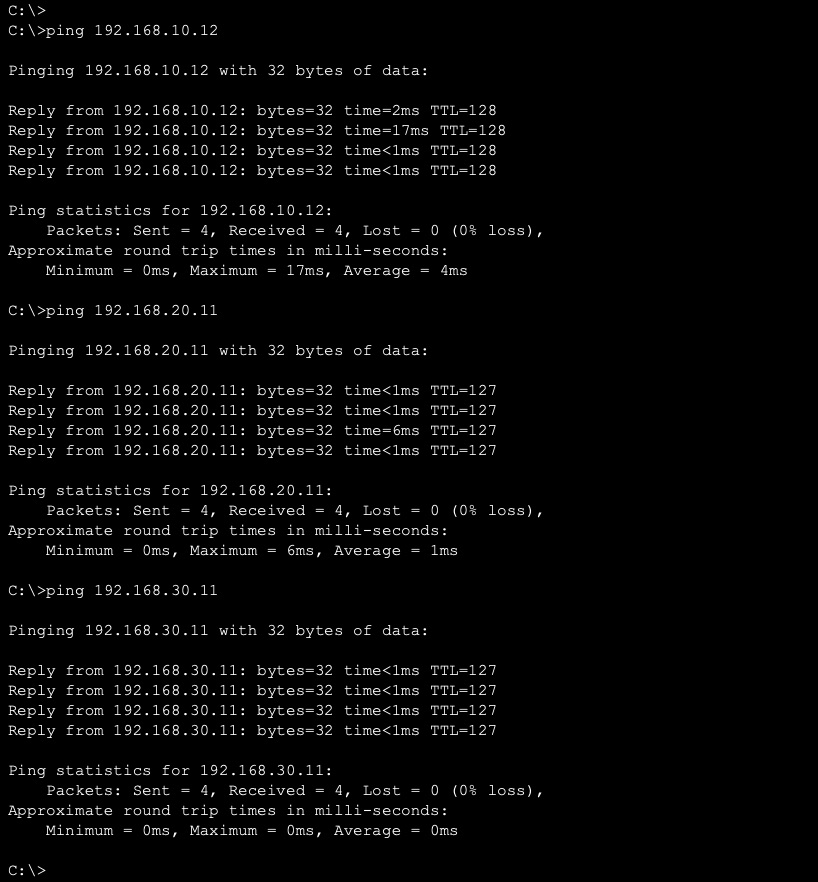
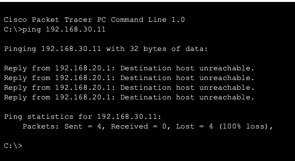

# Cisco Office Network — Small Office Network Lab

A small office network I built in **Cisco Packet Tracer** to practise networking and learn how routers, switches and different networks work together.

The network represents a small company with three departments: IT, HR and Sales. Each department has its own VLAN and subnet. 

I configured routing between them, automatic IP addressing with DHCP, and access control lists (ACLs) to restrict communication between departments.

This is a learning project, not a real company network.

## Why I made this

I'm studying Computer Science at TU Dublin and wanted to get more practical experience with computer networks.

Instead of only reading about VLANs, routers and IP addresses, I decided to build a small office network from scratch in Packet Tracer.

I started with one switch and three PCs, then gradually added more devices and configurations. 

The main goal was to understand what each part does and how to troubleshoot problems when something doesn't work.

## Network Topology



The network includes:

- 1 Cisco 2911 Router
- 3 Cisco 2960 Switches
- 6 PCs (2 per department)
- 3 VLANs — IT, HR and Sales

The switches are connected using trunk links. The router uses subinterfaces to communicate with the different VLANs (Router-on-a-Stick).

## What I configured

- **VLANs:** separated IT, HR and Sales into different logical networks.
- **IP addressing:** assigned separate IP subnets to each department.
- **Trunk ports:** configured connections between switches to carry VLAN traffic.
- **Inter-VLAN routing:** used router subinterfaces with 802.1Q encapsulation.
- **DHCP:** configured the router to automatically assign IP addresses.
- **ACLs:** blocked traffic between HR and Sales while allowing IT to communicate with both.
- **Network testing:** used `ping`, `ipconfig` and Cisco IOS commands to check the configurations.

## IP Addressing

| Department | VLAN | Network | Gateway |
|---|---|---|---|
|   IT  | 10 | 192.168.10.0/24 | 192.168.10.1 |
|   HR  | 20 | 192.168.20.0/24 | 192.168.20.1 |
| Sales | 30 | 192.168.30.0/24 | 192.168.30.1 |

Each department has a separate subnet, with the router acting as the default gateway.

## How I built it

I worked on the network step by step:

1. Started with one switch and three PCs to practise basic connections and IP addressing.
2. Expanded the topology to three switches and six PCs.
3. Created VLANs for the IT, HR and Sales departments.
4. Configured access ports and trunk connections between switches.
5. Added a Cisco router and configured Router-on-a-Stick.
6. Set up DHCP pools for automatic IP addressing.
7. Added ACL rules to block communication between HR and Sales.
8. Tested connectivity and checked that the restrictions worked.

## Testing

I used the Command Prompt in Packet Tracer to test communication between the devices.

### Ping Tests



The tests from IT-PC1 showed:

| Test | Result |
|---|---|
| IT-PC1 → IT-PC2    | Success (0% loss) |
| IT-PC1 → HR-PC1    | Success (0% loss) |
| IT-PC1 → SALES-PC1 | Success (0% loss) |

This confirmed that communication within IT and routing to the other two departments were working.

### ACL Testing



I configured ACLs to prevent communication between HR and Sales.

When testing a ping from HR to Sales, the router returned `Destination host unreachable`, which was consistent with the configured restriction.

## Problems I ran into (and what I learned)

- **Ping didn't work at the beginning.** Even with the cables connected and the IP addresses configured, I was getting 100% packet loss.

- I learned to check the IP configuration, interface status and test the local TCP/IP stack using `ping 127.0.0.1`.

- **Cisco CLI commands.** I made some typing mistakes when entering commands.

- I learned to read error messages and check the configuration using commands such as `show vlan brief` and `show interfaces trunk`.

- **Understanding VLANs.** At first, I didn't fully understand the difference between access ports and trunk ports.

- Configuring both helped me understand why they are needed.

- **Connecting different networks.** I learned that creating VLANs doesn't automatically allow communication between them.

- I needed a router and subinterfaces to make that work.

- **Network security.** I practised using ACLs and testing whether the restrictions actually worked.

## Project Structure

```text
cisco-office-network/
├── NetworkOffice.pkt
├── README.md
└── screenshots/
    ├── network-topology.png
    ├── ping-tests.png
    └── acl-tests.png
```

## How to Run

You need Cisco Packet Tracer.

1. Download `NetworkOffice.pkt` from this repository.
2. Open the file in Cisco Packet Tracer.
3. Explore the network topology and device configurations.
4. Open a PC → Desktop → Command Prompt to test connectivity.
5. Use the CLI on the router or switches to inspect the configurations.

## How I used AI

I used AI while working on this project to help plan the network, understand Cisco commands and troubleshoot problems.

I'm still learning networking, so I try to understand what the commands do.

## Known Limitations

- The network was built and tested in Packet Tracer, not on physical Cisco equipment.
- It is a small network with only six PCs.
- There is no internet connection configured.
- The ACL rules are basic and do not cover every possible security requirement.
- I haven't tested the network under heavy traffic.

## Ideas for Next Steps

- Add a server for DNS or internal services.
- Add Wi-Fi for employees and guests.
- Configure a connection to an external network.
- Practise more advanced ACL rules.
- Learn more about troubleshooting and network monitoring.

## Author

Second-year Computer Science student at TU Dublin.

Built as a personal learning project to practise networking and improve my technical skills.

Feedback is welcome.
